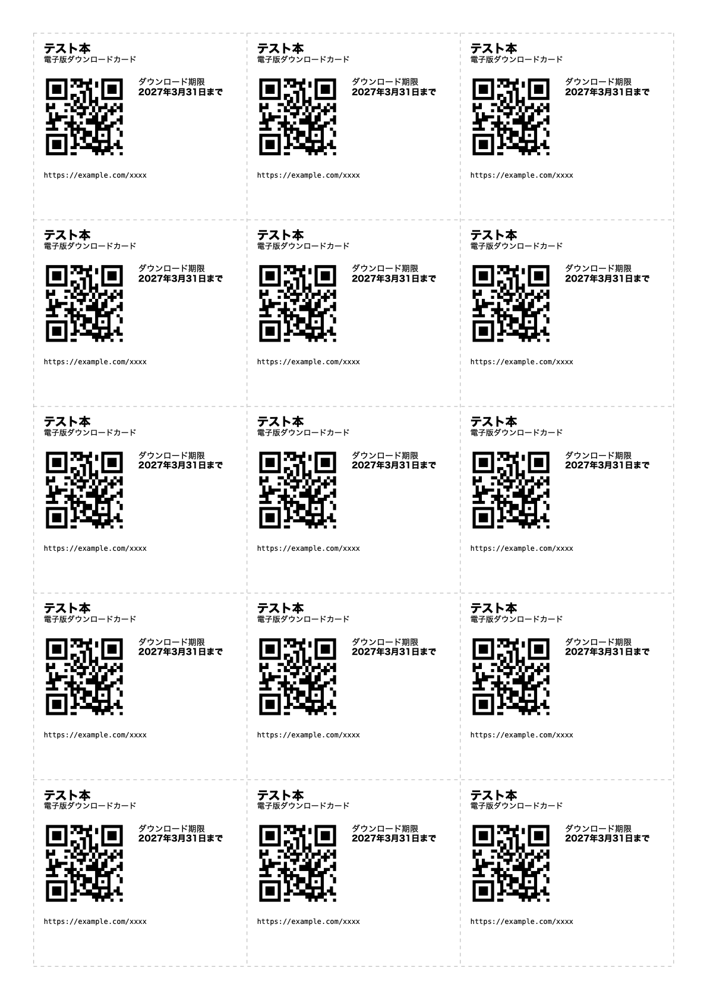

# download-card-maker

技術同人誌の電子版ダウンロードカードを、A4 の印刷用 PDF として作るツールです。書籍名・ダウンロード URL・期限を渡すと、URL の QR コードと文字の両方を載せたカードを A4 に並べます（既定は横3枚×縦5枚）。家庭用プリンタやコンビニのネットプリントで刷り、点線で切って使う想定です。

1回の実行では、全カードに同じ内容を刷ります。本が複数あるときは、本ごとに実行してください。

## 必要なもの

- [Typst](https://typst.app/) 0.13 以降（動作を確かめたのは 0.15.1）
- 日本語フォント（ヒラギノ、Noto Sans CJK JP、Noto Sans JP、游ゴシックのいずれか。ほかのフォントは `--font` で指定できます）
- bash

QR コードは Typst のパッケージ [tiaoma](https://typst.app/universe/package/tiaoma) で描きます。初回の実行時に自動でダウンロードされるため、インターネットへの接続が必要です。

## インストール

### mise を使う場合

[mise](https://mise.jdx.dev/) を入れてあれば、`mise.toml` に書いたバージョンの Typst がそろいます。

```sh
git clone https://github.com/ik11235/download-card-maker.git
cd download-card-maker
mise trust
mise install
```

### mise を使わない場合

Typst を直接入れます。

```sh
# macOS
brew install typst
# そのほかの環境: https://github.com/typst/typst#installation
```

Linux で日本語フォントがなければ、Noto Sans CJK JP を入れてください（例: `sudo apt install fonts-noto-cjk`）。

## 使い方

```sh
./make-cards.sh \
  --title "初めての3Dプリンタ" \
  --url "https://example.com/download" \
  --deadline "2027年3月31日まで" \
  --circle "サークル名" \
  --note "※購入者本人のみ利用できます／再配布禁止" \
  -o cards.pdf
```

mise を使う場合は `mise run cards -- --title ... ` のように、`--` のあとに同じ引数を並べます。

| 引数 | 必須 | 内容 |
|---|---|---|
| `--title` | ○ | 書籍名 |
| `--url` | ○ | ダウンロード URL。QR コードと文字の両方で刷る |
| `--deadline` | ○ | ダウンロード期限。書いた文字列がそのまま刷られる |
| `--circle` | | サークル名。省略すると表示しない |
| `--note` | | 注意書き。省略すると表示しない |
| `--cols` | | 横の枚数（既定: 3） |
| `--rows` | | 縦の枚数（既定: 5） |
| `--font` | | 日本語フォント名。省略すると上の候補から環境にあるものを選ぶ。名前は `typst fonts` で確認できる |
| `-o`, `--output` | | 出力先（既定: `cards.pdf`） |

### Typst を直接使う

`make-cards.sh` は `typst compile` を呼んでいるだけなので、次のように直接実行してもかまいません。

```sh
typst compile \
  --input title="初めての3Dプリンタ" \
  --input url="https://example.com/download" \
  --input deadline="2027年3月31日まで" \
  --input cols=3 --input rows=5 \
  cards.typ cards.pdf
```

## 実行例

```sh
mise run cards -- --title "テスト本" --url "https://example.com/xxxx" --deadline "2027年3月31日まで"
```

上のコマンドで作った PDF を画像にしたものです（既定の 3×5）。



## レイアウト

- 用紙は A4、余白は 10mm です。余白の内側を列数×行数で等分し、1枚の大きさを決めます。3×5 なら約 63×55mm です
- カードの境界に、切り取り線として灰色の点線を引きます
- QR コードの大きさはカードに合わせて変わり、最小は 15mm です。周りに読み取り用の白い余白を取ります
- URL は等幅フォントで刷り、長いときは途中で折り返します
- 列数や行数を増やして文字がカードに入りきらなくなっても、エラーにはしません。PDF を見て確かめてください

刷る前に、PDF の QR コードをスマートフォンで読み取り、正しい URL が開くことを確かめてください。

## ライセンス

[MIT](LICENSE)
